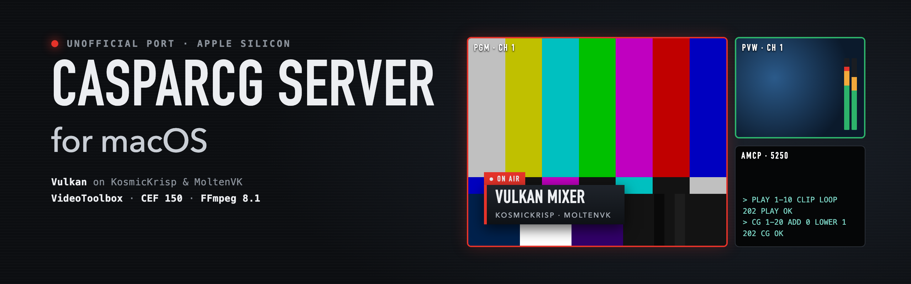
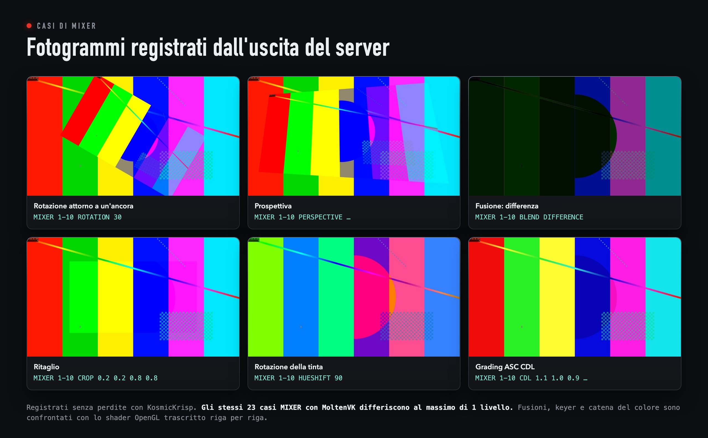
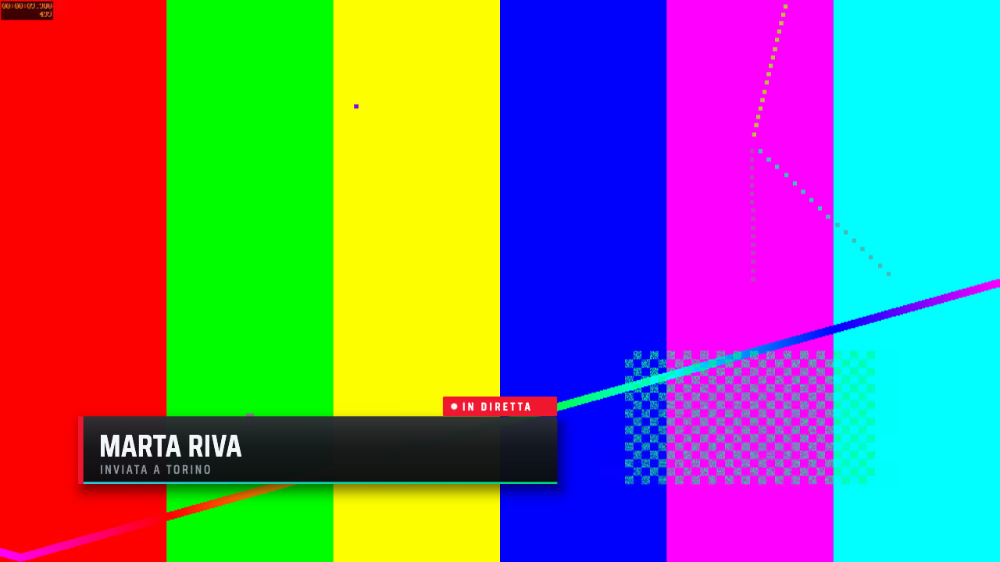
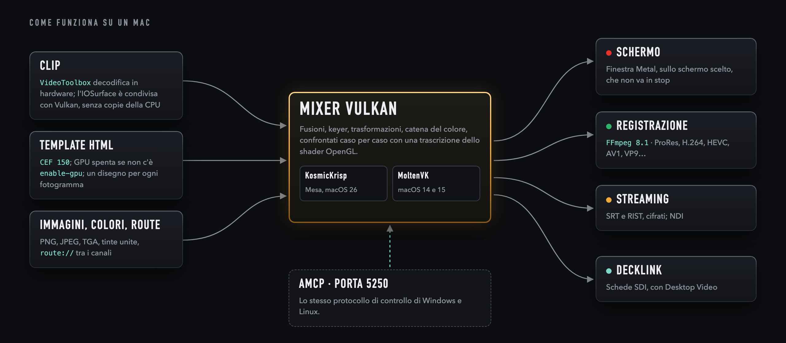
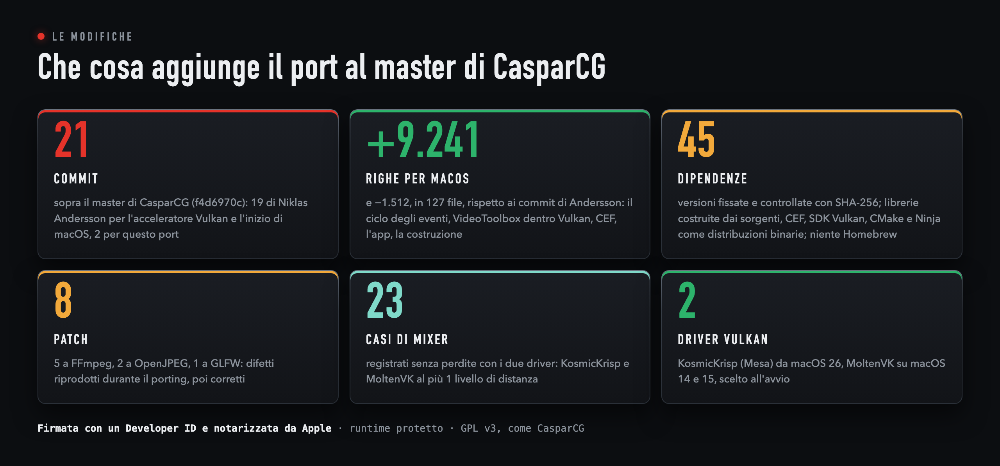
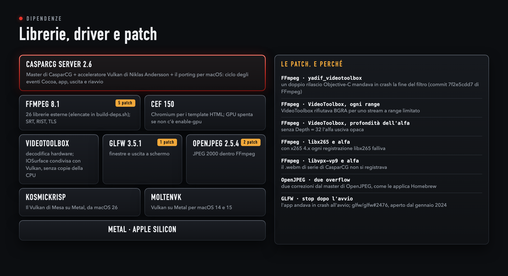
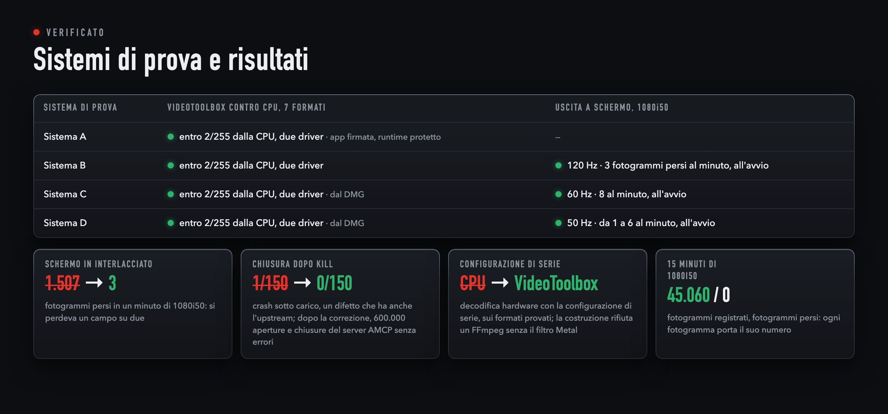

<p align="center">
  
</p>

<p align="center"><a href="README.md">English</a> &nbsp;·&nbsp; <b>Italiano</b></p>

<p align="center">
  
  
  
  
  
  
  
</p>

Questo è il mio porting non ufficiale di **CasparCG Server**, il server open source di messa in onda e grafica, su macOS
e Apple silicon. Non ho legami con SVT né con il progetto CasparCG; il porting è offerto a loro e a tutti con la stessa
licenza.

macOS non ha più un OpenGL aggiornato, quindi il porting parte dall'acceleratore **Vulkan** di Niklas Andersson. Una
parte è già nel `master` di CasparCG, un passo alla volta (#1677, #1782, #1817); il resto del suo ramo
(`vulkan-accel-rework-v2`) è portato qui, sopra il `master` (f4d6970c, 27 ottobre 2026). Il porting lo fa girare su due
driver scelti all'avvio: **KosmicKrisp** (Mesa) da macOS 26, **MoltenVK** prima.

**Il supporto al Mac l'ha cominciato Niklas Andersson**, nell'agosto 2026 e sullo stesso ramo: la prima versione per
macOS con il pacchetto di un'app firmata e notarizzata, l'uscita a schermo Vulkan per macOS e la decodifica hardware
con VideoToolbox ([`ccdbabd`](https://github.com/niklaspandersson/casparcg-server/commit/ccdbabdcc9c40bfa4a136c6e437d4c7b7f942362), [`8fb4ef4`](https://github.com/niklaspandersson/casparcg-server/commit/8fb4ef4b047c9f98cb88dad79734165dd4b85401), [`4cf5a83`](https://github.com/niklaspandersson/casparcg-server/commit/4cf5a83de187acb3b7f951433924be7464e624d0)). Questo porting
continua il suo lavoro.

## Scaricare l'app e primi passi

Nelle [release](../../releases) c'è un DMG con l'app, **firmata con un Developer ID e notarizzata da Apple**: si apre su
qualunque Mac con Apple silicon e macOS 14 o successivo senza avvisi di Gatekeeper, e il ticket di notarizzazione è
incorporato nell'app, quindi si apre anche senza rete. Ogni release dice che cosa è cambiato e come è stato verificato.
Restano anteprime finché non passano le prove lunghe di qualificazione (8, 24 e 72 ore): a che punto sono lo dice
[Prove di qualificazione](#prove-di-qualificazione).

Si apre il DMG, si trascina **CasparCG Server** in Applicazioni e si avvia l'app. Al primo avvio crea
`~/Library/Application Support/CasparCG Server`, con le cartelle `media`, `template`, `log` e `data` e il
`casparcg.config` di serie: un canale 720p50 mostrato in una finestra, con l'audio del Mac, e AMCP sulla porta 5250,
aperto solo a questo Mac. Le clip vanno in `media`, i template HTML in `template`. Per cambiare canali e uscite si modifica lì `casparcg.config`, poi
si manda `RESTART` o si chiude e si riapre.

Il driver Vulkan si sceglie all'avvio: KosmicKrisp da macOS 26, MoltenVK prima.
`<vulkan-driver>moltenvk</vulkan-driver>` nella configurazione ne impone uno (`kosmickrisp`, `moltenvk` o `auto`).

Il protocollo AMCP è invariato, quindi i client esistenti si collegano come su Windows e Linux. Nel
[CasparCG Client](https://github.com/CasparCG/client) ufficiale (la 2.3.1 ha una versione per Apple silicon) si aggiunge
un server con indirizzo `127.0.0.1` e porta `5250`. Una verifica veloce dal Terminale:

```sh
(printf 'VERSION\r\n'; sleep 1) | nc 127.0.0.1 5250    # 201 VERSION OK, poi la versione
```

AMCP non ha password, qui come in ogni CasparCG Server: chi raggiunge la porta può comandare il server, aprire pagine web
e template e registrare file ovunque l'utente del Mac possa scrivere, anche fuori da `media`. Per questo la configurazione
di serie lo tiene su questo Mac. Per comandare il server da un altro computer, su una rete fidata, si toglie
`<host>127.0.0.1</host>` da `<tcp>` in `casparcg.config`, si manda `RESTART` e si usa l'indirizzo del Mac, permettendo le
connessioni in entrata se macOS lo chiede.

L'elenco di media e template (`CLS`, `TLS`, miniature) passa da un media scanner sulla porta 8000 (`<media-server>` nella
configurazione). Le anteprime non ne contengono ancora uno; il primo rilascio avrà un media scanner dentro l'app (vedi
[Che cosa viene dopo](#che-cosa-viene-dopo)).

## La verifica del mixer

L'obiettivo è che il mixer Vulkan dia la stessa uscita del mixer OpenGL di Windows e Linux. Ogni caso si confronta con lo
shader OpenGL trascritto riga per riga, usando colori con tutti i canali diversi, e i due driver Vulkan si confrontano
fra loro; le prove del grading ammettono 1 LSB. Un confronto diretto con una build per Windows o Linux non è ancora stato fatto. Dove
sbagliava il codice OpenGL stesso (i fotogrammi `abgr`), è corretto in tutti e due i mixer.

<p align="center"></p>

<p align="center">
  <br>
  <sub>Un fotogramma registrato dall'uscita del server: le barre colore di una clip ProRes e, sopra, un sottopancia HTML
  disegnato da CEF.</sub>
</p>

## Come funziona su un Mac

<p align="center"></p>

- **Le clip** le decodifica in hardware **VideoToolbox** e passano a Vulkan senza copie della CPU: MoltenVK importa
  l'IOSurface come immagine, KosmicKrisp come memoria attraverso un buffer, e segue una copia sulla GPU nelle texture del
  mixer. H.264, HEVC a 10 bit, ProRes 422 HQ, 4444, 4444 XQ e 4444 con alfa (decodificato in BGRA a 8 bit; la
  decodifica CPU conserva la profondità piena), ProRes interlacciato deinterlacciato sulla GPU, e AV1 dove il Mac lo
  decodifica in hardware.
- **I template HTML** girano in **CEF 150**. Il disegno sulla GPU è spento di serie e si accende con
  `<html><enable-gpu>true</enable-gpu></html>`, che serve ai template WebGL. In una cattura NetLog di 20 minuti Chromium
  non ha fatto richieste sue a Google; le richieste fatte dai template stessi non sono filtrate.
- **Le uscite** sono una finestra Metal sullo schermo scelto, registrazione e streaming con **FFmpeg 8.1** (26 librerie
  esterne, elencate in `tools/macos/build-deps.sh`), NDI e DeckLink.
- **Il controllo** resta AMCP sulla porta 5250, invariato.

## Modifiche e dipendenze

<p align="center"></p>

Questa è una versione modificata di CasparCG Server. Parte dal `master` di CasparCG a f4d6970c (27 ottobre 2026); sopra
ci sono 19 commit di Niklas Andersson, a suo nome, e poi i commit con le modifiche di questo porting, fatte a partire
dall'ottobre 2026:

- `tools/macos/package.sh` viene dal ramo di Niklas Andersson, dove già costruiva un'app firmata e notarizzata e un DMG
  con le librerie di Homebrew. Qui è riscritto per una costruzione dai sorgenti: `build-deps.sh` costruisce le
  dipendenze, l'app contiene le licenze di ciò che porta con sé e `notarize.sh` firma e notarizza un'app già costruita
  sul Mac che ha il Developer ID.
- Il mixer Vulkan segue il mixer OpenGL, come misura [La verifica del mixer](#la-verifica-del-mixer), e la correzione di
  `abgr` vale anche per il mixer OpenGL.
- La decodifica VideoToolbox è di Niklas Andersson, e su MoltenVK condivideva già i fotogrammi con Vulkan senza copie
  della CPU. Il porting aggiunge lo stesso per KosmicKrisp, una cache delle superfici limitata, i formati `nv16`, `p210`,
  `p416` e `ayuv`, e AV1 dove il Mac lo decodifica in hardware.
- Anche il consumer a schermo Vulkan per macOS è suo. Il porting gli fa mostrare tutti e due i campi sui canali
  interlacciati, fa scegliere lo schermo a `<device>` anche in finestra, tiene sveglio lo schermo e corregge una perdita
  di semafori e un crash quando tutti gli schermi dormono.
- Il consumer FFmpeg ha diverse correzioni, e `STREAM` tiene una coda di 8 fotogrammi (`<stream-buffer>`).
- Su macOS CEF passa dalla 131 alla versione ufficiale 150, con le richieste di Chromium a Google di sua iniziativa
  spente.
- L'app si chiude in modo pulito dal menu, dal Dock o alla disconnessione, si riavvia sul posto e si riprende dalla
  perdita del dispositivo GPU. I comandi di un client che si chiude subito non vanno più persi, e sono corretti un crash
  e tre problemi di concorrenza alla chiusura.
- Un consumer di anteprima mette in memoria condivisa l'immagine, i picchi audio e il loudness EBU R 128.
- La configurazione di serie tiene AMCP su questo Mac (`<host>127.0.0.1</host>`), perché AMCP non ha password.
- I proxy dei consumer ora inoltrano `needs_host_frame()`, quindi un canale con la sola uscita a schermo Vulkan evita la
  lettura dalla GPU, e un consumer che ha bisogno dei byte salta il fotogramma che non li ha.
- Ci sono gli header dell'SDK DeckLink per macOS e il percorso del runtime NDI.

Le dipendenze sono fissate con il loro SHA-256 in `tools/macos/deps.list` e `src/CMakeModules/Bootstrap_Mac.cmake`. Le librerie si costruiscono dai sorgenti;
CEF, l'SDK Vulkan, CMake e Ninja si usano come distribuzioni binarie. Dove una dipendenza falliva su macOS il difetto è
stato prima riprodotto e poi corretto; le patch sono in `tools/macos/patches/`, e quelle scritte per questo porting si
possono proporre ai rispettivi progetti.

<p align="center"></p>

## Che cosa è stato verificato

<p align="center"></p>

Su quattro sistemi Apple silicon, con tutti e due i driver, da script che registrano l'uscita senza perdite e la
confrontano con un riferimento:

| Area | Che cosa |
|---|---|
| Mixer | fusioni, keyer, catena del colore (livelli, CDL, grading), livelli specchiati e ritagliati, bordi PAL e NTSC, route, 23 casi `MIXER` |
| Decodifica | VideoToolbox contro la decodifica CPU, un fotogramma per formato e per driver, nessun pixel oltre 2 livelli di distanza; con la configurazione di serie e su ProRes interlacciato; WebM con alfa tramite libvpx |
| HTML | colori e trasparenze esatti; un `requestAnimationFrame` per ogni fotogramma d'uscita, anche col runtime protetto |
| Registrazione e streaming | i codec predefiniti dei contenitori e 13 encoder; SRT e RIST cifrati; TLS con verifica dei certificati; 15 minuti di 1080i50 con ogni fotogramma numerato, nessuno perso |
| Uscita a schermo | i canali interlacciati mostrano tutti e due i campi: a 120, 60 e 50 Hz al massimo 8 fotogrammi persi al minuto, tutti all'avvio |
| Canali con il solo schermo | nessuna lettura dalla GPU finché sul canale c'è solo l'uscita a schermo Vulkan. Su un sistema, in 1080p50 e 1080i50 con tutti e due i driver, un `FILE` aggiunto e tolto 30 volte senza errori, registrazioni leggibili, `route://` e `ADD IMAGE` funzionanti; su un secondo sistema l'immagine a schermo è la stessa con e senza un `FILE` |
| Durata | 30 minuti con tre canali 1080p50 e una prova di stress della GPU, puliti; 8 ore con due canali 1080i50 da otto livelli ciascuno e 24 ore con uno, completate: vedi [Prove di qualificazione](#prove-di-qualificazione) |
| Ripristino | `RESTART` sul posto, ripresa dopo la perdita del dispositivo GPU, un limite di 30 secondi a una chiusura bloccata, uscita dal Dock, 150 `KILL` sotto carico |
| Consumer di anteprima | la sua memoria condivisa resta sotto un prefisso proprio, quindi un nome mandato via AMCP lascia intatta quella di un altro programma; un'anteprima lasciata da un server ucciso viene sostituita; il server ha continuato a girare mentre un altro processo riscriveva l'intestazione |
| Riservatezza | nessuna richiesta di Chromium a Google di sua iniziativa in una cattura NetLog di 20 minuti |

Gli script di regressione sono stati rieseguiti sul codice attuale il 1° novembre 2026, su un sistema: 14 su 14 superati.

## Prove di qualificazione

Le soglie, fissate prima delle prove: nessun fotogramma perso a regime, un giro AMCP entro 50 ms al 99° percentile, una
memoria che cresce al massimo di 10 MiB all'ora. Ogni fotogramma della clip in cima a ogni canale porta il suo numero,
e alla fine le registrazioni si rileggono fotogramma per fotogramma.

| Prova | Sistema e build | Carico | Esito |
|---|---|---|---|
| **8 ore**, 25–26 ottobre 2026 | sistema B, KosmicKrisp, il server dell'anteprima 2 (`5D86421E`) | due canali 1080i50 da otto livelli ciascuno; lo schermo sul primo, file (x264) e SRT su tutti e due; una clip che entra ed esce con un MIX ogni 30 s | **Completata; la soglia della memoria non è rispettata.** I due file: 1.440.308 e 1.440.254 fotogrammi, nessuno perso, ripetuto o fuori ordine. Nessun errore nel registro, uscita pulita. AMCP: mediana 1,6 ms, 99° percentile 4,1 ms, massimo 21,7 ms. La memoria è salita di circa 220 MiB nelle prime quattro ore, poi le medie orarie sono rimaste fra 3.095 e 3.172 MiB; la pendenza misurata dopo le prime due ore è di 26 MiB all'ora, sopra la soglia di 10. SRT: un fotogramma perso a regime su un canale, vedi [Limiti noti](#limiti-noti). |
| **24 ore**, 26–27 ottobre 2026 | sistema D, macOS 26.6.2, KosmicKrisp, l'app notarizzata dell'anteprima 2 | un canale 1080i50 da otto livelli; uscite su file e SRT, niente schermo; una clip ogni 30 s | **Completata, con due rilievi.** Nessun errore nel registro, uscita pulita; AMCP: mediana 1,6 ms, 99° percentile 7,6 ms, massimo 83 ms; in media 2,2 core del processore. Il file: 4.320.528 fotogrammi, nessuno perso, ma **10 ripetuti** in un unico stallo di 0,6 secondi dopo 4 ore e 26 minuti (26 ottobre, 07:00), nello stesso minuto in cui la memoria del server è salita di circa 900 MiB; in quel minuto sullo stesso Mac partivano altri lavori programmati, e la causa non è ancora stabilita. A parte quello scalino, la memoria è cresciuta di circa 6 MiB all'ora (medie orarie da 2.659 a 2.773 MiB nelle ultime 18 ore). SRT: 4.501 fotogrammi persi in 3.155 salti, vedi [Limiti noti](#limiti-noti). |

Le prove di 8 e 24 ore hanno usato il server dell'anteprima 2 e nessuna delle due è stata ripetuta sul codice attuale,
che sta sopra un `master` più recente e permette ai canali con il solo schermo di evitare la lettura dalla GPU. La prova
di 72 ore è ancora da fare.

## Limiti noti

- **SRT** non è qualificato sotto carico pesante. Il ricevitore perde il primo secondo o i primi due di un flusso, mentre la
  connessione si stabilisce (da 47 a 101 fotogrammi nelle mie prove), e poi nessuno con un carico leggero (15
  minuti di 1080i50). Sotto carico pesante (due canali 1080i50 da otto livelli, con un file e un'uscita SRT ciascuno)
  si è perso un solo fotogramma in otto ore su un canale, e una prova di tre minuti ne aveva perso uno ogni 90 secondi
  circa; i file registrati nello stesso tempo non ne hanno perso nessuno. Sul sistema D, con un canale così per 24
  ore e il ricevitore sullo stesso Mac, si sono persi 4.501 fotogrammi in 3.155 salti. Una causa è corretta: il consumer
  STREAM teneva una coda di un solo fotogramma e scartava in silenzio; ora ne tiene 8 (`<stream-buffer>`, da 1 a 64) e
  registra ogni scarto. Le prove brevi migliorano, ma la correzione non ha ancora fatto una prova lunga.
- **DeckLink** è compilato ma non è stato provato su una scheda vera: va verificato sull'hardware.
- **L'uscita a schermo** perde qualche fotogramma quando parte (da 1 a 8 al minuto a 50, 60 e 120 Hz, tutti
  all'avvio).
- **Il consumer FILE su un canale interlacciato** registra a frequenza di campo (50 immagini al secondo per il
  1080i50), come fa il progetto originale (`// TODO - field alignment` in `ffmpeg_consumer.cpp`).
- **L'app senza uscita a schermo** non ha icona nel Dock né menu: si chiude con `KILL`. Se all'avvio nessuno schermo è
  sveglio, l'uscita a schermo fallisce e va riaggiunta con `ADD 1 SCREEN`.
- **Le registrazioni** seguono i valori predefiniti del progetto originale: FFmpeg sceglie il formato che perde meno,
  quindi libx264 registra `yuv444p` e libx265 RGB; per la consegna se ne sceglie uno, per esempio
  `-filter:v format=yuv420p`.
- **Un'uscita SRT in ascolto** regge un collegamento solo; un ricevitore respinto per la chiave sbagliata fa cadere la
  trasmissione.
- **`drawtext`** richiede `fontfile=`: nell'app non c'è fontconfig. **x265 con l'alfa** è spento, come in Homebrew.
- **Solo Apple silicon**, macOS 14 o successivo. NDI non è nelle anteprime: `package.sh --ndi` lo aggiunge a una
  build propria, dopo aver letto la licenza dell'SDK NDI.

## Come si costruisce

Ogni dipendenza è fissata con il suo SHA-256, in `tools/macos/deps.list` e, per vk-bootstrap e VulkanMemoryAllocator, in
`src/CMakeModules/Bootstrap_Mac.cmake`; Homebrew non serve.

```sh
tools/macos/build-deps.sh ~/casparcg-work   # le dipendenze, FFmpeg con 26 librerie esterne
tools/macos/build.sh ~/casparcg-work         # il server, in ./build
tools/macos/package.sh ~/casparcg-work       # dist/CasparCG Server.app e un DMG
```

Per gli shader Metal di FFmpeg serve Xcode (con Xcode 27.1 gli strumenti Metal si scaricano a parte:
`xcodebuild -downloadComponent MetalToolchain`); su un Mac con i soli Command Line Tools si compilano altrove con
`tools/macos/prebuild-metal.sh` e si passano con `METAL_PREBUILT`. Senza né l'uno né l'altro `build-deps.sh` si ferma,
e `package.sh` rifiuta un FFmpeg senza `yadif_videotoolbox`: con la configurazione di serie quell'FFmpeg decodificherebbe
ogni clip sulla CPU. `METAL=none` lo costruisce senza, apposta. `package.sh --sign <identità>` firma col runtime
protetto; `--ndi <libndi.dylib>` aggiunge NDI (prima leggere la licenza dell'SDK NDI). `--scanner <binario>`
mette un media scanner in `Contents/Helpers`, con `ffmpeg` e `ffprobe` di FFmpeg legati alle librerie dell'app; il server lo
avvia con `--config`, `--host`, `--port`, `--genitore`, `--ffmpeg` e `--ffprobe`.

`tools/macos/notarize.sh <app> <cartella> <identità> <profilo>` firma un'app già costruita con un Developer ID, sul Mac
che lo ha nel Portachiavi, notarizza l'app e poi un DMG che la contiene, e incorpora il ticket in entrambi; il profilo è
un profilo `notarytool` del Portachiavi, oppure `asc` per una chiave API di App Store Connect in `~/.appstoreconnect`.

## L'app

- Aperta dal Finder lavora in `~/Library/Application Support/CasparCG Server`, creata al primo avvio con la
  configurazione di serie. Con un file di configurazione come argomento si comporta come sugli altri sistemi.
- L'uscita (⌘Q, il Dock, la fine della sessione) chiude il server in modo pulito quando l'app ha una finestra; `RESTART`
  lo riesegue sul posto.
- Se l'app contiene un media scanner in `Contents/Helpers`, il server lo avvia con sé se `<media-server>` è `127.0.0.1` o
  `localhost`, su quella porta, aspetta la porta se la tiene un altro programma, e lo chiude all'uscita e al riavvio. Uno scanner che
  cade dopo almeno 30 secondi viene riavviato; uno che finisce prima resta spento, e il registro dice perché. Dopo un crash
  del server lo scanner deve chiudersi da solo, osservando il pid che riceve con `--genitore`.
  `<media-scanner>none</media-scanner>` lo lascia spento, per usare uno scanner proprio.
- `THIRD-PARTY-NOTICES.txt`, dentro l'app, riporta le licenze delle librerie e dei driver che contiene; i componenti di
  Chromium sono elencati in `chrome://credits`.

## Che cosa viene dopo

Il primo rilascio, dopo la prova di 72 ore, sarà CasparCG Server per macOS con un media scanner semplice dentro l'app. Il
suo nucleo compatibile è scritto in Swift; contro lo scanner ufficiale 1.4.0, sulla stessa cartella, ha dato 97 risposte
identiche su 97 (`CLS`, `TLS`, `FLS`, `CINF`, miniature, JSON), anche mentre i file cambiavano. Restano due differenze note,
l'ordine di `TLS` e `FLS` e un caso di nomi in collisione.

Il lavoro sul porting continuerà poi con una finestra di console nativa e la finestra DIAG per l'app, DeckLink su una
scheda vera e lo SRT sotto carico pesante.

## Contribuire

Difetti e suggerimenti nelle [Issues](../../issues), correzioni come pull request, vulnerabilità solo per mail: vedi
[CONTRIBUTING.it.md](CONTRIBUTING.it.md) e [SECURITY.md](SECURITY.md).

## Riconoscimenti e licenza

CasparCG Server è di SVT e dei suoi contributori ([README del progetto originale](README.upstream.md)); l'acceleratore Vulkan è
di Niklas Andersson, che ne ha cominciato anche il supporto al Mac; KosmicKrisp del progetto Mesa; MoltenVK del Khronos Group; CEF di Marshall Greenblatt e dei suoi
contributori; FFmpeg e le librerie elencate in `tools/macos/deps.list` dei rispettivi autori.

Ho definito gli obiettivi e i requisiti di questo porting, e ne dirigo e verifico lo sviluppo. Il codice è stato
prodotto con l'intelligenza artificiale sotto la mia direzione ed è stato provato su hardware vero.

Questo porting è software libero, con la **GNU General Public License, versione 3 o successiva**, come CasparCG Server
([LICENSE](LICENSE)). Ogni componente di terze parti mantiene la sua licenza.
