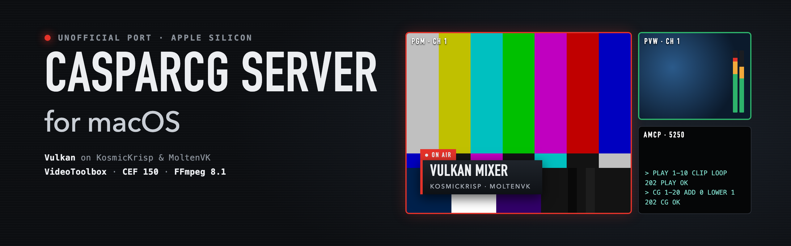
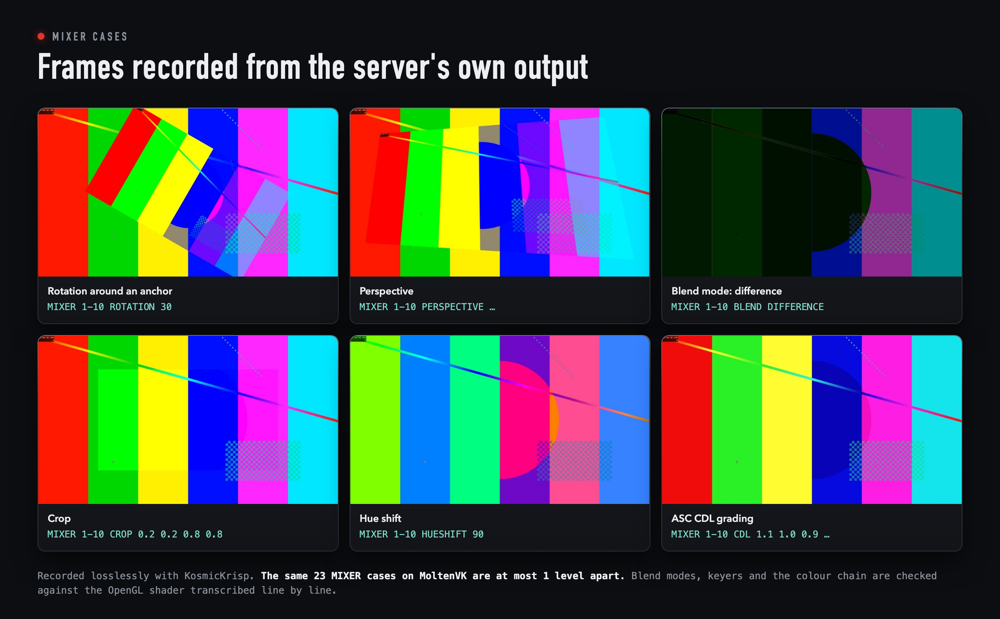
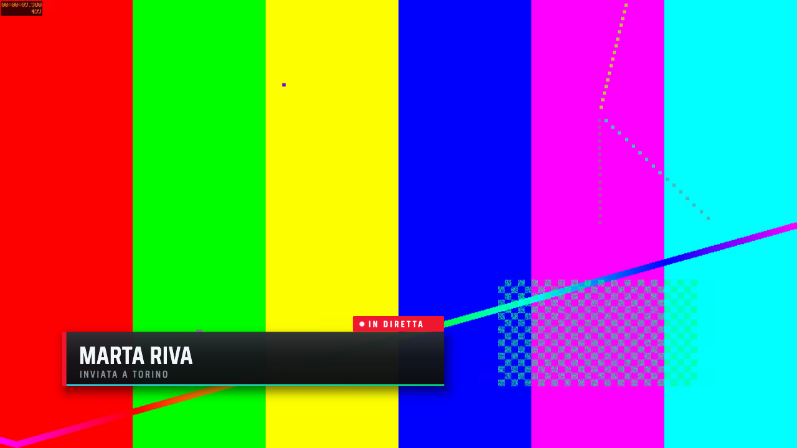
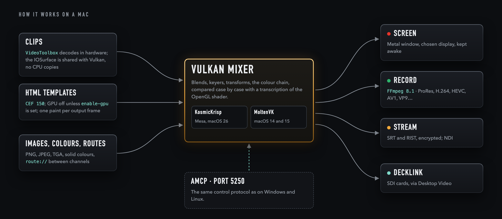
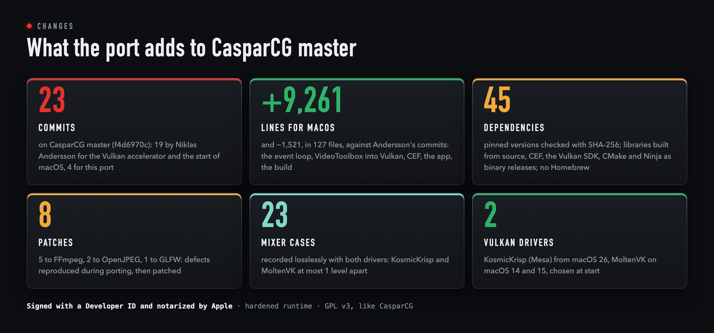
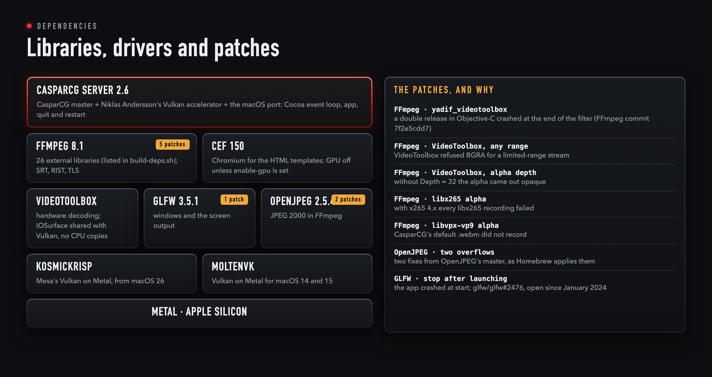
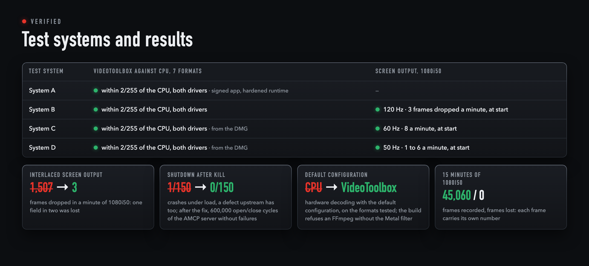

<p align="center">
  
</p>

<p align="center"><b>English</b> &nbsp;·&nbsp; <a href="README.it.md">Italiano</a></p>

<p align="center">
  
  
  
  
  
  
  
</p>

This is my unofficial port of **CasparCG Server**, the open-source playout and graphics server, to macOS on Apple
silicon. I am not affiliated with SVT or the CasparCG project; the port is offered to them and to everyone under the
same licence.

macOS has no current OpenGL, so this port builds on Niklas Andersson's **Vulkan** accelerator. Part of it is already in
CasparCG `master`, step by step (#1677, #1782, #1817); the rest of his branch (`vulkan-accel-rework-v2`) is carried here,
rebased on `master` (f4d6970c, 27 October 2026). The port runs it on two drivers chosen at startup: **KosmicKrisp** (Mesa) from macOS 26, **MoltenVK** before.

**The macOS support itself was started by Niklas Andersson**, in August 2026 on that same branch: the initial macOS
support with the packaging of a signed and notarized app, the Vulkan screen consumer for macOS and hardware decoding
with VideoToolbox ([`ccdbabd`](https://github.com/niklaspandersson/casparcg-server/commit/ccdbabdcc9c40bfa4a136c6e437d4c7b7f942362), [`8fb4ef4`](https://github.com/niklaspandersson/casparcg-server/commit/8fb4ef4b047c9f98cb88dad79734165dd4b85401), [`4cf5a83`](https://github.com/niklaspandersson/casparcg-server/commit/4cf5a83de187acb3b7f951433924be7464e624d0)). This port
carries his work on.

## Download and first steps

The [releases](../../releases) carry a DMG with the app, **signed with a Developer ID and notarized by Apple**: it opens
on any Mac with Apple silicon and macOS 14 or later without a Gatekeeper warning, and the ticket is stapled, so it opens
offline too. Each release lists what changed and how it was checked. They are previews until the long qualification
runs (8, 24 and 72 hours) have passed: see [Qualification runs](#qualification-runs) for where they stand.

Open the DMG, drag **CasparCG Server** into Applications and start the app. On first start it creates
`~/Library/Application Support/CasparCG Server`, with the `media`, `template`, `log` and `data` folders and the default
`casparcg.config`: one 720p50 channel shown in a window, with the Mac's sound, and AMCP on port 5250, open to this Mac
only. Clips go in `media`,
HTML templates in `template`. To change channels and outputs, edit `casparcg.config` there, then send `RESTART` or quit
and reopen.

The Vulkan driver is chosen at start: KosmicKrisp from macOS 26, MoltenVK before.
`<vulkan-driver>moltenvk</vulkan-driver>` in the configuration forces one (`kosmickrisp`, `moltenvk` or `auto`).

The AMCP protocol is unchanged, so existing clients connect as they do on Windows and Linux. In the official
[CasparCG Client](https://github.com/CasparCG/client) (2.3.1 has a build for Apple silicon) add a server with address
`127.0.0.1` and port `5250`. A quick check from Terminal:

```sh
(printf 'VERSION\r\n'; sleep 1) | nc 127.0.0.1 5250    # 201 VERSION OK, then the version
```

AMCP has no password, here as in every CasparCG Server: whoever reaches the port can control the server, open web pages
and templates, and record files anywhere the Mac's user can write, also outside `media`. That is why the default
configuration keeps it on this Mac. To control the server from another computer, on a network you trust, remove
`<host>127.0.0.1</host>` from `<tcp>` in `casparcg.config`, send `RESTART` and use the Mac's address, allowing incoming
connections if macOS asks.

Listing media and templates (`CLS`, `TLS`, thumbnails) goes through a media scanner on port 8000 (`<media-server>` in the
configuration). The previews don't carry one yet; the first release will carry a media scanner inside the app (see
[Roadmap](#roadmap)).

## Mixer verification

The goal is for the Vulkan mixer to produce the same output as the OpenGL mixer of Windows and Linux. Each case is
compared with the OpenGL shader transcribed line by line, using colours whose channels all differ, and the two Vulkan
drivers are compared with each other; the grading tests allow 1 LSB. There has been no direct comparison with a Windows or Linux build yet.
Where the OpenGL code itself was wrong (`abgr` frames), it is fixed in both mixers.

<p align="center"></p>

<p align="center">
  <br>
  <sub>A frame recorded from the server's output: colour bars from a ProRes clip, and an HTML lower third rendered by
  CEF on top.</sub>
</p>

## How it works on a Mac

<p align="center"></p>

- **Clips** are decoded in hardware by **VideoToolbox** and shared with Vulkan without CPU copies: MoltenVK imports the
  IOSurface as an image, KosmicKrisp as memory through a buffer, and a GPU copy into the mixer's textures follows.
  H.264, HEVC 10 bit, ProRes 422 HQ, 4444, 4444 XQ and 4444 with alpha (decoded as 8-bit BGRA; CPU decoding keeps the
  full depth), interlaced ProRes deinterlaced on the GPU, and AV1 where the Mac decodes it in hardware.
- **HTML templates** run in **CEF 150**. GPU rendering is off by default and is switched on with
  `<html><enable-gpu>true</enable-gpu></html>`, which WebGL templates need. In a 20-minute NetLog capture Chromium made
  no requests of its own to Google; requests made by the templates themselves are not filtered.
- **Outputs** are a Metal window on the chosen display, recording and streaming with **FFmpeg 8.1** (26 external
  libraries, listed in `tools/macos/build-deps.sh`), NDI and DeckLink.
- **Control** stays AMCP on port 5250, unchanged.

## Changes and dependencies

<p align="center"></p>

This is a modified version of CasparCG Server. It starts from CasparCG `master` at f4d6970c (27 October 2026); on top of
that come 19 commits by Niklas Andersson, under his name, and then the commits with the changes of this port, made from
October 2026:

- `tools/macos/package.sh` comes from Niklas Andersson's branch, where it already built a signed and notarized app and
  a DMG from Homebrew libraries. Here it is rewritten around a build from source: `build-deps.sh` builds the
  dependencies, the app carries the licences of what it ships, and `notarize.sh` signs and notarizes a built app on the
  Mac that holds the Developer ID.
- The Vulkan mixer follows the OpenGL mixer, as [Mixer verification](#mixer-verification) measures, and the `abgr` fix
  also applies to the OpenGL mixer.
- VideoToolbox decoding is Niklas Andersson's, and on MoltenVK it already shared frames with Vulkan without CPU copies.
  The port adds the same for KosmicKrisp, a bounded surface cache, the `nv16`, `p210`, `p416` and `ayuv` formats, and
  AV1 where the Mac decodes it in hardware.
- The Vulkan screen consumer for macOS is also his. The port makes it show both fields on interlaced channels, lets
  `<device>` pick the display in a window too, keeps the display awake, and fixes a semaphore leak and a crash when
  every display is asleep.
- The FFmpeg consumer has several fixes, and `STREAM` keeps a queue of 8 frames (`<stream-buffer>`).
- CEF on macOS moves from 131 to the official build of 150, with Chromium's own requests to Google switched off.
- The app quits cleanly from the menu, the Dock or a logout, restarts in place and recovers from a lost GPU device.
  Commands of a client that closes at once are no longer lost, a client that resets the connection no longer stops AMCP
  from accepting the next ones, and one crash and three races at shutdown are fixed.
- A preview consumer puts the picture, audio peaks and EBU R 128 loudness in shared memory.
- The default configuration keeps AMCP on this Mac (`<host>127.0.0.1</host>`), because AMCP has no password.
- The consumer proxies now forward `needs_host_frame()`, so a channel with only the Vulkan screen output skips the GPU
  readback, and a consumer that needs the bytes skips a frame that has none.
- The macOS DeckLink SDK headers and the NDI runtime path are in place.

Dependencies are pinned with their SHA-256 in `tools/macos/deps.list` and `src/CMakeModules/Bootstrap_Mac.cmake`. Libraries are built from source; CEF, the Vulkan
SDK, CMake and Ninja are used as binary releases. Where a dependency failed on macOS the fault was reproduced and then
patched; the patches are in `tools/macos/patches/`, and the ones written for this port can be offered to their projects.

<p align="center"></p>

## What was verified

<p align="center"></p>

On four Apple silicon systems, with both drivers, by scripts that record the output losslessly and compare it with a
reference:

| Area | What |
|---|---|
| Mixer | blend modes, keyers, the colour chain (levels, CDL, grading), mirrored and cropped layers, PAL and NTSC borders, routes, 23 `MIXER` cases |
| Decoding | VideoToolbox against CPU decoding, one frame per format and driver, no pixel more than 2 levels apart; with the default configuration and on interlaced ProRes; WebM with alpha through libvpx |
| HTML | exact colours and transparency; one `requestAnimationFrame` per output frame, also under the hardened runtime |
| Recording and streaming | the muxers' default codecs and 13 encoders; SRT and RIST with encryption; TLS with certificate checks; 15 minutes of 1080i50 with every frame numbered, none lost |
| Screen output | interlaced channels show both fields: at 120, 60 and 50 Hz at most 8 frames dropped a minute, all at start |
| Screen-only channels | no GPU readback while only the Vulkan screen output is on the channel. On one system, in 1080p50 and 1080i50 with both drivers, a `FILE` added and removed 30 times with no error, recordings readable, `route://` and `ADD IMAGE` working; on a second system the picture on screen is the same with and without a `FILE` |
| Endurance | 30 minutes with three 1080p50 channels and a GPU stress test, clean; 8 hours with two 1080i50 channels of eight layers each and 24 hours with one, completed: see [Qualification runs](#qualification-runs) |
| Preview consumer | its shared memory stays under its own prefix, so a name sent over AMCP leaves another program's untouched; a preview left by a killed server is replaced; the server kept running while another process overwrote the header |
| Recovery | `RESTART` in place, recovery from a lost GPU device, a 30-second limit on a hanging shutdown, quit from the Dock, 150 `KILL`s under load |
| AMCP | clients that leave at once, 300 in each of three ways (a normal close, a reset after a command, a reset before any command): the next client was always answered |
| Privacy | no requests of Chromium's own to Google in a 20-minute NetLog capture |

The regression scripts ran again on the current code on 4 November 2026, on one system: 14 out of 14 passed.

## Qualification runs

The thresholds, set before the runs: no frame lost in steady state, an AMCP round trip within 50 ms at the 99th
percentile, memory growing by at most 10 MiB an hour. Every frame of the clip on top of each channel carries its own
number, and the recordings are read back frame by frame at the end.

| Run | System and build | Load | Result |
|---|---|---|---|
| **8 hours**, 25–26 Oct 2026 | system B, KosmicKrisp, the server of preview 2 (`5D86421E`) | two 1080i50 channels with eight layers each; the screen on the first, file (x264) and SRT on both; a clip mixed in and out every 30 s | **Completed; the memory threshold was not met.** The two files: 1,440,308 and 1,440,254 frames, none lost, repeated or out of order. No error in the log, clean exit. AMCP median 1.6 ms, 99th percentile 4.1 ms, worst 21.7 ms. Memory rose by about 220 MiB in the first four hours, then hourly means stayed between 3,095 and 3,172 MiB; the slope measured after the first two hours is 26 MiB an hour, above the 10 MiB threshold. SRT: one frame lost in steady state on one channel, see [Known limits](#known-limits). |
| **24 hours**, 26–27 Oct 2026 | system D, macOS 26.6.2, KosmicKrisp, the notarized app of preview 2 | one 1080i50 channel with eight layers; file and SRT outputs, no screen; a clip every 30 s | **Completed, with two findings.** No error in the log, clean exit; AMCP median 1.6 ms, 99th percentile 7.6 ms, worst 83 ms; 2.2 CPU cores on average. The file: 4,320,528 frames, none lost, but **10 repeated** in a single 0.6-second stall 4 h 26 min in (26 Oct, 07:00), the same minute in which the server's memory stepped up by about 900 MiB; other scheduled work on the same Mac started at that minute, and the cause is not yet established. Apart from that step, memory grew by about 6 MiB an hour (hourly means 2,659 → 2,773 MiB over the last 18 hours). SRT: 4,501 frames lost in 3,155 gaps, see [Known limits](#known-limits). |

The 8- and 24-hour runs used the server of preview 2, and neither has been repeated on the current code, which is
rebased on a newer `master` and lets screen-only channels skip the GPU readback. The 72-hour run is still to be done.

## Known limits

- **SRT** is not qualified under heavy load. The receiver misses the first one or two seconds of a stream while the connection is
  established (47 to 101 frames in my runs), and none after that under a light load (15 minutes of 1080i50). Under
  heavy load (two 1080i50 channels with eight layers, a file and an SRT output each) one single frame was lost in
  eight hours on one channel, and a three-minute run had shown one every 90 seconds or so; the files recorded at the
  same time lost none. On system D with one such channel for 24 hours, with the receiver on the same Mac, 4,501
  frames were lost in 3,155 gaps. One cause is fixed: the STREAM consumer kept a queue of a single frame and dropped
  frames silently; it now keeps 8 (`<stream-buffer>`, 1 to 64) and logs every drop. Short runs improve, but the fix has
  not been through a long run yet.
- **DeckLink** is built in but has not been tested on a real card: to be verified on hardware.
- **The screen output** drops a few frames when it starts (1 to 8 a minute at 50, 60 and 120 Hz, all at start).
- **The file consumer on an interlaced channel** records at field rate (50 images a second for 1080i50), as upstream
  does (`// TODO - field alignment` in `ffmpeg_consumer.cpp`).
- **The app without a screen output** has no Dock icon or menu: stop it with `KILL`. With no display awake at start the
  screen output fails and has to be added again with `ADD 1 SCREEN`.
- **Recordings** follow upstream's defaults: FFmpeg picks the least lossy format, so libx264 records `yuv444p` and libx265
  RGB; for delivery choose one, for example `-filter:v format=yuv420p`.
- **An SRT output in listener mode** serves one connection; a receiver rejected for a wrong key drops the stream.
- **`drawtext`** needs `fontfile=`: there is no fontconfig in the app. **x265 with alpha** is off, as in Homebrew.
- **Apple silicon only**, macOS 14 or later. NDI is not in the previews: `package.sh --ndi` adds it to a build of
  your own, after reading the NDI SDK licence.

## Building

Every dependency is pinned with its SHA-256, in `tools/macos/deps.list` and, for vk-bootstrap and VulkanMemoryAllocator, in
`src/CMakeModules/Bootstrap_Mac.cmake`; Homebrew is not needed.

```sh
tools/macos/build-deps.sh ~/casparcg-work   # the dependencies, FFmpeg with 26 external libraries
tools/macos/build.sh ~/casparcg-work         # the server, in ./build
tools/macos/package.sh ~/casparcg-work       # dist/CasparCG Server.app and a DMG
```

Xcode is needed for FFmpeg's Metal shaders (with Xcode 27.1 the Metal toolchain is a separate download:
`xcodebuild -downloadComponent MetalToolchain`); on a Mac with only the Command Line Tools, compile them elsewhere with
`tools/macos/prebuild-metal.sh` and pass `METAL_PREBUILT`. Without either, `build-deps.sh` stops, and `package.sh`
refuses an FFmpeg without `yadif_videotoolbox`: with the default configuration that FFmpeg would decode every clip on
the CPU. `METAL=none` builds without it on purpose. `package.sh --sign <identity>` signs with the hardened runtime;
`--ndi <libndi.dylib>` adds NDI (read the NDI SDK licence first). `--scanner <binary>` puts a media scanner in
`Contents/Helpers`, with FFmpeg's `ffmpeg` and `ffprobe` made to load the app's own libraries; the server starts it with
`--config`, `--host`, `--port`, `--genitore`, `--ffmpeg` and `--ffprobe`.

`tools/macos/notarize.sh <app> <out-dir> <identity> <profile>` signs a built app with a Developer ID on the Mac that
holds it, notarizes the app and then a DMG that carries it, and staples both; the profile is a `notarytool` keychain
profile, or `asc` for an App Store Connect API key in `~/.appstoreconnect`.

## The app

- Opened from the Finder, it works in `~/Library/Application Support/CasparCG Server`, created on first start with the
  default configuration. With a configuration file as argument it behaves as on other systems.
- Quit (⌘Q, the Dock, a logout) shuts the server down cleanly when the app has a window; `RESTART` re-executes it in
  place.
- When the app carries a media scanner in `Contents/Helpers`, the server starts it with itself when `<media-server>` is
  `127.0.0.1` or `localhost`, on that port, waits for the port if something else holds it, and ends it on quit and restart. A scanner that
  falls after at least 30 seconds is started again; one that ends sooner stays off, and the log says why. After a crash
  of the server the scanner is expected to end by itself, watching the pid it gets with `--genitore`.
  `<media-scanner>none</media-scanner>` leaves it off, for a scanner of your own.
- `THIRD-PARTY-NOTICES.txt` inside the app carries the licences of the libraries and drivers it ships; Chromium's own
  components are listed in `chrome://credits`.

## Roadmap

The first release, after the 72-hour run, will be CasparCG Server for macOS with a simple media scanner inside the app.
Its compatible core is written in Swift; against the official scanner 1.4.0 on the same folder it gave 97 identical
answers out of 97 (`CLS`, `TLS`, `FLS`, `CINF`, thumbnails, JSON), also while files changed. Two known differences remain,
the order of `TLS` and `FLS` and one name-collision case.

Work on the macOS port then goes on with a native console window and the DIAG window for the app, DeckLink on a real card
and SRT under heavy load.

## Contributing

Bugs and suggestions in [Issues](../../issues), fixes as pull requests, vulnerabilities by mail only: see
[CONTRIBUTING.md](CONTRIBUTING.md) and [SECURITY.md](SECURITY.md).

## Credits and licence

CasparCG Server is by SVT and its contributors ([upstream README](README.upstream.md)); the Vulkan accelerator by Niklas
Andersson, who also started its macOS support; KosmicKrisp by the Mesa project; MoltenVK by the Khronos Group; CEF by Marshall Greenblatt and contributors;
FFmpeg and the libraries in `tools/macos/deps.list` by their authors.

I defined the goals and requirements of this port, and I direct and verify its development. The code was produced
with AI under my direction and tested on real hardware.

This port is free software under the **GNU General Public License, version 3 or later**, as CasparCG Server is
([LICENSE](LICENSE)). Each third-party component keeps its own licence.
